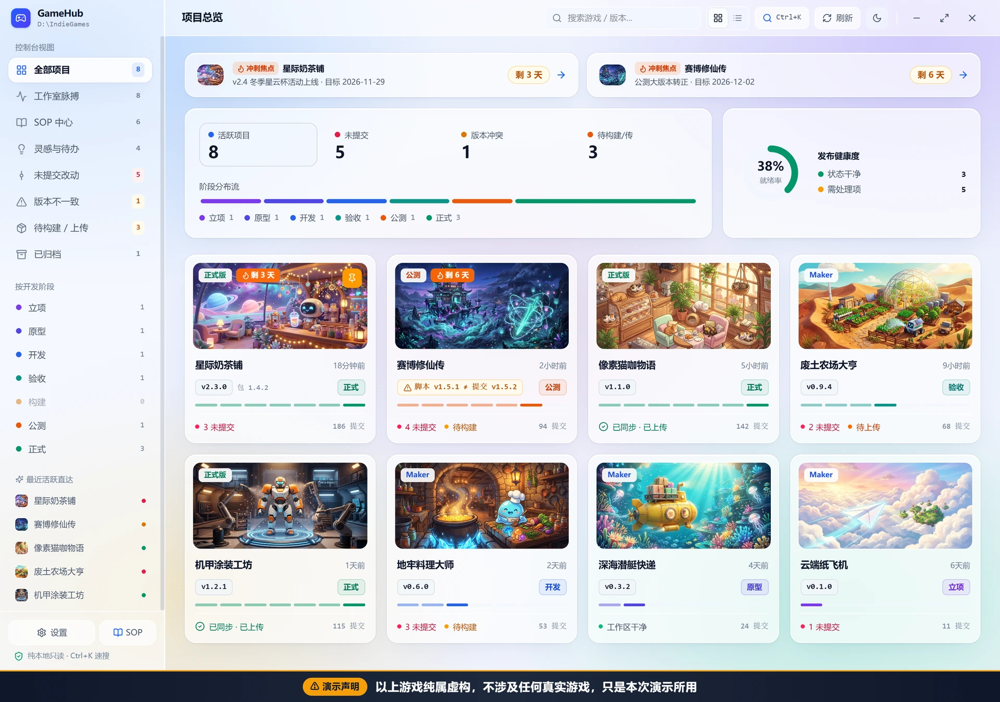
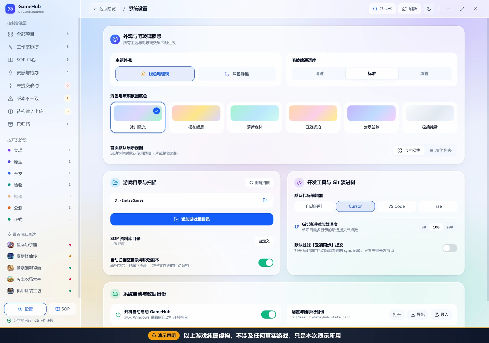
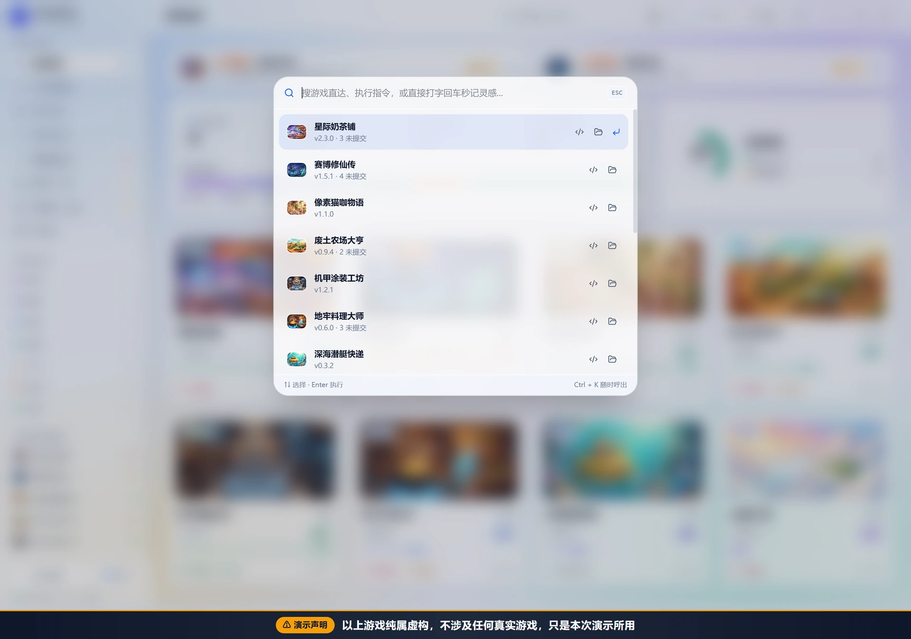

<div align="center">

# 🎮 GameHub 游戏总控台 & TapTap Maker 开发 SOP

**专为独立游戏开发者与 TapTap Maker 创作者打造的开源 Windows 苹果毛玻璃桌面工作台**

[](./LICENSE)
[](https://github.com/1dragons/TapTap-Maker-GameHub/releases)
[](#目录结构)
[](#隐私与安全设计)
[](https://github.com/1dragons/TapTap-Maker-GameHub/releases)

<p>
  <a href="#实机演示教程">实机演示</a> ·
  <a href="#界面预览">界面预览</a> ·
  <a href="#核心特性">核心特性</a> ·
  <a href="#快速开始">快速开始</a> ·
  <a href="./sop">内置 SOP</a> ·
  <a href="./CHANGELOG.md">更新日志</a> ·
  <a href="#目录结构">目录结构</a> ·
  <a href="#隐私与安全设计">隐私与安全</a>
</p>

<br />


<p><strong>⚠️ 演示声明：以上游戏纯属虚构，不涉及任何真实游戏，只是本次演示所用。</strong></p>

</div>

<br />

> **为什么做 GameHub？**  
> 当你的硬盘里同时推进着七八款甚至十几款独立小游戏时，最消耗心力的往往不是写代码本身，而是每天反复确认：**「每个项目做到哪一步了？哪些改动还没提交？版本号和构建包对得上吗？昨晚想到的好点子记哪了？换一个 AI 会话继续开发又要重头交代背景？」**  
> **GameHub** 采用清爽的 **Apple 浅色毛玻璃（Liquid Glass）** 设计语言，**100% 纯本地只读扫描**（不上传数据、不改动游戏源码），并开箱内置整套 **TapTap Maker 小游戏开发 SOP 手册与模板**，把多项目掌控感还给创作者。

---

## 实机演示教程

> 🎬 **42 秒 6 步实机上手导览（含语音解说，点击播放器右下角可开启声音）**：  
> `01 自动扫描总览` → `02 资产与 7 阶段流程` → `03 多分支 Git 演进树` → `04 一键复制 AI 上下文` → `05 Ctrl+K 全局命令面板` → `06 20 周热力图 & 32 份开发 SOP`  
> *(画面中出现的游戏名称纯属虚构 · 仅作功能演示)*

https://github.com/user-attachments/assets/92b6a2b6-464e-4058-808d-fbee3fcdd648

---

## 界面预览

> [!IMPORTANT]
> **演示声明：以上游戏纯属虚构，不涉及任何真实游戏，只是本次演示所用。**（所有游戏名称、封面、AppID `XXXXXX` 与本地路径均为虚构演示数据）

### 1. 首页总览 · 苹果毛玻璃多项目总控台
一眼看清冲刺焦点倒计时、活跃项目数、阶段分布、发布就绪率、版本冲突与未提交改动；自动抓取游戏美术封面，支持画廊网格与精简表格双视图切换。



### 2. 单项目深度工作台 · 多轨道 SVG Git 演进树 & 流程图
自动统计代码行数与贴图/模型/音频资产体积、绘制近 14 天开发节奏、串联 7 阶段苹果圆章流程图、发光多分支 SVG Git 演进树、四色灵感随手记与构建/上传三段打卡雷达。


### 3. 更多高效模块一览

<table>
  <tr>
    <td width="50%" align="center">
      
      <br />
      <strong>🔥 工作室脉搏 · 20 周全景热力图</strong>
      <br />
      <sub>聚合全工作室提交记录、连续开发天数、单日峰值与跨游戏动态流</sub>
    </td>
    <td width="50%" align="center">
      
      <br />
      <strong>📖 内置开源 SOP 中心（30+ 篇手册）</strong>
      <br />
      <sub>覆盖立项、原型、正式制作与验收，支持全文检索与「一键复制给 AI」</sub>
    </td>
  </tr>
  <tr>
    <td width="50%" align="center">
      
      <br />
      <strong>🎨 苹果风系统设置 · 6 款毛玻璃氛围底色</strong>
      <br />
      <sub>浅色/深色一键切换、三档毛玻璃通透度、编辑器偏好与一键备份</sub>
    </td>
    <td width="50%" align="center">
      
      <br />
      <strong>⌨️ <code>Ctrl + K</code> 全局 Spotlight 命令面板</strong>
      <br />
      <sub>任意页面秒搜游戏直达、唤起编辑器/文件夹，或直接回车秒记灵感</sub>
    </td>
  </tr>
</table>

---

## 核心特性

| 创作痛点 | GameHub 如何解决 |
| :--- | :--- |
| 项目一多就忘记做到哪一步、缺什么待办 | **Bento 总览仪表盘 + 7 阶段苹果圆章流程图**，全盘进度与冲刺倒计时一眼掌控 |
| 脚本版本号、Git 提交、构建/上传经常对不上 | **自动比对脚本版本与 Git 提交**，三段雷达打卡「最新代码 → 最近构建 → 最近上传」 |
| 看纯文字 `git log` 眼花，工作区改了啥记不清 | **高颜值多轨道 SVG Git 演进树**，树顶脉冲提示未提交工作区，点击即看改动明细 |
| 换个 AI 对话继续开发，每次都要重头复述背景 | **一键复制 AI 续接上下文**，自动打包路径、版本、冲刺目标、未提交文件、提交摘要与待办 |
| 上线后要来回翻 TapTap 评价和论坛找 Bug | **TapTap 玩家评价 & 论坛问题雷达**，首次全量 + 后续增量去重拉取，本地自动归类痛点，支持 AI 按思考强度一键总结并转待办 |
| 缺少一套能直接落地的小游戏工程开发规范 | **开箱内置 30+ 篇 TapTap Maker 开发 SOP**，软件内随时查阅并一键喂给 AI 协作 |

### 1. 多项目总览控制台（少字、重图表、零杂乱）
- **智能目录扫描**：支持配置一个或多个本地游戏根目录，自动识别主力项目、嵌套子目录 Git 仓库与无 Git 项目；自动归档空目录/副本，支持仅在软件内移除或一键恢复。
- **Bento 可视化状态条 & 健康圆环**：一眼掌握全盘开发阶段分布、就绪率、未提交改动、脚本与提交版本冲突、待构建/上传项目。
- **双视图切换**：支持画廊式内嵌封面卡片网格（自动抓取游戏美术封面，支持自定义名称与拖放换图）与 Stripe 风格精简表格列表。
- **冲刺焦点 & 发版倒计时**：给正在冲刺的游戏设定目标发版日与里程碑短句，首页顶部自动亮起倒计时聚焦条。

### 2. 单项目深度工作台
- **沉浸式毛玻璃封面横幅**：自动读取项目品类、横竖屏、AppID、TapTap 广告位配置，并提供 TapTap 商店页 / 开发者中心 / 自定义外链传送门。
- **macOS 风格工程资产条 + 近 14 天开发节奏图**：自动统计脚本文件数与总代码行数、贴图、3D 模型、音频数量与资源包体积，并一键直达项目进度/设计/验收/QA 报告。
- **苹果圆章渐变开发流程图**：`立项 → 原型 → 开发 → 验收 → 构建 → 公测 → 正式`，点击任意节点即可切换阶段或管理待办。
- **高颜值 SVG Git 演进树**：
  - 发光渐变主干线 + 多分支平滑贝塞尔曲线 + 菱形分日时间锚点；
  - 工作区有未提交改动时，树顶自动挂出红色脉冲「未提交工作区」节点，点击滑出改动文件明细；
  - 自动按 **版本里程碑 / 功能 / 修复 / 优化 / 云端同步** 语义着色，支持按类型一键筛选、过滤零碎同步、搜索提交与查看增删统计条。
- **随手记 & 待办事宜工作卡**：四色灵感便签（灵感 / 美术 / 坑点 / 变现），支持一键将好灵感「转待办」；优先级待办勾选与 `.sop` 自动导入。
- **构建与上传三段雷达**：对比「最新代码 → 最近构建 → 最近上传」，一键打卡变绿。
- **TapTap 玩家评价 & 论坛问题雷达（v1.1.0 新增）**：
  - **首次全量 + 二次增量去重同步**：按需手动抓取 TapTap 公开评分、1★~5★ 星级分布、玩家评价（含机型与游玩时长）及论坛帖子，后续增量同步秒抓新增项并高亮 `NEW` 徽标；
  - **零配置本地痛点聚合**：不配任何 API Key 即可按「闪退/卡死、广告/激励、存档/丢档、数值/难度、操作/UI、建议/好评」自动归类，支持筛选 `差评 ≤3★` / `本次新增`、一键「复制给 AI」以及任意评价/帖子一键「转待办」；
  - **可选内置 AI 诊断（自带 Key / 本地 Ollama）**：支持 DeepSeek、通义千问、MiniMax、智谱 GLM、本地 Ollama 及任意 OpenAI 兼容接口（支持一键拉取实时 `/models` 列表），内置 **4 档思考强度**（极速关闭思考 / 轻度推荐 / 深度 / 极致），一键输出 P0/P1/P2 问题清单与排查建议。

### 3. AI 协作 & 发版提效神器
- **一键复制 AI 续接上下文**：自动打包当前游戏的本地路径、引擎与版本、冲刺目标、未提交文件摘要、最近关键提交、待办事宜和随手记，粘贴给任何 AI 编程助手即可 1 秒接手继续开发。
- **一键从 Git 生成本版更新日志**：自动过滤云端同步提交，按「新增内容 / 体验优化 / 问题修复」生成可编辑的玩家向更新公告草稿。
- **`Ctrl + K` 苹果 Spotlight 全局命令面板**：任意页面按 `Ctrl + K` 秒搜游戏直达、一键唤起编辑器/文件夹、或直接打字回车秒记全局灵感。

### 4. 工作室脉搏 & 内置小游戏开发 SOP
- **工作室脉搏（20 周全景热力图）**：聚合所有活跃游戏的开发提交，呈现 GitHub 风格绿格子热力图、连续开发天数、单日峰值纪录、跨游戏动态流与精力分布。
- **内置 TapTap Maker 小游戏开发 SOP v2.0 & 四件套 AI 技能（[`sop/`](./sop)）**：开箱内置 34 篇 v2.0 实战流程与工程避坑规范（含 UrhoX/Lua 避坑、存档直升与风控、3D 场景动线、OPT 商业化与全比例安全区、三排矢量全屏流程图），并打包完整 **4 套 AI 技能**（`taptap-maker-sop`、`taptap-maker-qa` 含静态审计与 HTML 验收看板脚本、`mini-game-version-ops`、`game-diagnosis` 含 GamePropel HTML 诊断看板脚本），支持在软件内**一键安装到 Antigravity / Codex / Claude Code / Cursor**。

### 5. 完整的苹果风系统设置
- **6 款苹果柔彩毛玻璃氛围背景**（冰川极光 / 樱花暖晨 / 薄荷森林 / 日落琥珀 / 紫罗兰梦 / 极简纯雪）+ **三档毛玻璃通透度** + 浅色/深色一键切换；
- 默认代码编辑器偏好（自动识别 / Cursor / VS Code / Trae）、Git 加载深度与默认过滤同步；
- 原生 Windows 开机自启开关、**软件内一键检测更新与无损原地升级**（自动区分安装版与绿色便携版，升级前自动备份 `hub-state.json` 并通过 SHA-256 校验，100% 保留配置与数据）及一键 JSON 备份导入导出。

---

## 快速开始

### 方式一：直接下载安装包（推荐，无需配置环境）
前往 **[Releases 页面](https://github.com/1dragons/TapTap-Maker-GameHub/releases)** 下载最新版 Windows 发行包（GitHub Releases 已自动提供官方 SHA-256 校验）：
- **安装版**：`GameHub-*-win-x64-setup.exe`（自动创建桌面快捷方式）
- **绿色便携版**：`GameHub-*-win-x64-portable.zip`（解压后双击 `GameHub.exe` 即可运行）

---

### 方式二：开发者源码运行 & 打包

#### 环境要求
- Windows 10 / 11（64 位）
- [Node.js](https://nodejs.org/) 20+
- 本机已安装 `git` 并加入 PATH

#### 1. 克隆并安装依赖
```bash
git clone https://github.com/1dragons/TapTap-Maker-GameHub.git
cd TapTap-Maker-GameHub
npm install
```

> [!TIP]
> 国内网络环境如遇 Electron 下载较慢，可在 `npm install` 前设置镜像：
> ```powershell
> $env:ELECTRON_MIRROR="https://npmmirror.com/mirrors/electron/"
> $env:ELECTRON_BUILDER_BINARIES_MIRROR="https://npmmirror.com/mirrors/electron-builder-binaries/"
> npm install
> ```

#### 2. 直接启动桌面软件
```bash
npm run start
```

#### 3. 打包成独立免安装 Windows `.exe`
```bash
npm run pack:win
```
打包完成后，独立客户端位于 `release/win-unpacked/GameHub.exe`，可直接右键「发送到 → 桌面快捷方式」日常双击启动。

---

## 目录结构

```text
GameHub/
├── electron/          # Electron 主进程：项目扫描器、只读 Git 引擎、资产统计、热力图、SOP 引擎与本地存储
├── src/               # React + TypeScript + Tailwind CSS 苹果毛玻璃前端界面
├── sop/               # 内置开源版 TapTap Maker 小游戏开发 SOP（流程 / 规范 / 模板 / 脚本）
├── docs/
│   └── screenshots/   # 开源宣传截图与合成海报（100% 虚构演示数据）
├── build/             # 应用多尺寸图标资源 (.ico / .png)
├── scripts/           # 辅助脚本（如矢量图标生成器）
└── package.json
```

---

## 隐私与安全设计

- **默认本地离线，联网仅按需触发**：软件自身无任何云端服务器、无埋点、无后台静默上报；仅在你主动点击「抓取评价 & 论坛」「拉取实时模型」或「AI 一键总结」时发起对应请求。
- **对游戏项目绝对只读**：仅执行只读 `git` 查询与文件元数据读取，绝不修改、提交或删除你游戏目录中的任何文件；软件内的「移除项目」也仅作用于软件列表，不碰硬盘文件。
- **个人数据与 API Key 严格本地隔离**：所有自定义名称、随手记、待办、打卡记录、抓取缓存与可选 AI API Key 仅保存在本地 `data/hub-state.json`（已被 `.gitignore` 忽略），绝不提交到代码仓库。

---

## 开源协议

本项目基于 [MIT License](./LICENSE) 开源，欢迎所有独立游戏开发者自由使用、二次定制与贡献 PR！如果觉得对你有帮助，欢迎点亮右上角的 **Star ⭐** 支持一下！
