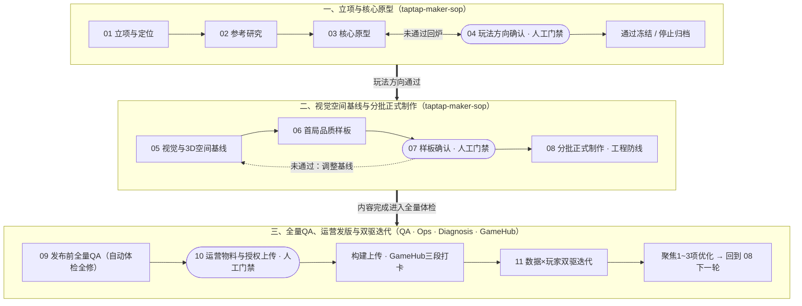

# 总流程与阶段标准

版本：2.0.0。适用于 2D / 3D、横屏 / 竖屏 TapTap Maker（UrhoX + Lua）小游戏全生命周期研发与线上迭代；无广告、无排行或单机轻量项目按实际范围裁剪。不可用文档数量判断品质。

## 四技能 + GameHub 协同分工

| 工具 / 技能 | 负责阶段 | 核心交付 |
| :--- | :--- | :--- |
| `taptap-maker-sop` | 01~08 制作全过程 | 立项、核心原型、视觉/3D 动线基线、分批制作与日常规范 |
| `taptap-maker-qa` | 09 发布前全量 QA | 静态扫描、官方 Lua 校验、8 维逻辑与老档直升审查、全自动修复与 HTML 看板 |
| `mini-game-version-ops` | 10 运营资料准备 | 限长运营文案（版本名/卖点/标签/更新重点）+ 16:9 头图与 2.5:1 搜索品牌专区图 |
| `game-diagnosis` | 11 线上数据诊断 | GamePropel CLI 留存/漏斗/关卡/广告只读诊断，输出 ≤3 个优化点与 HTML 看板 |
| `GameHub` 桌面总控台 | 全程总控与玩家原声 | Git 演进树、版本冲突预警、构建/上传三段打卡、TapTap 评价与论坛增量 AI 雷达 |

## 阶段表

| 阶段 | 输入 | 工作与交付 | 通过依据 | 不通过时 |
|---|---|---|---|---|
| 立项与定位 | 用户想法、平台与开发条件 | 明确玩家、题材情绪、2D/3D 与横竖屏选择、核心卖点、范围边界与风险 | 能说清玩家做什么、为何愿意试玩、如何用最小原型验证 | 缩减范围或归档，不先堆大系统 |
| 参考研究 | 题材、核心行为 | 拆解直接竞品、表现参考与交互语法，记录借鉴点与差异化 | 有可观察案例和适用理由，不以星标或爆款名气代替判断 | 换参考或收敛定位 |
| 核心原型 | 核心循环假设 | 最少资源实现行动→决策→反馈→下一轮；3D 项目先出平面分区图与白模验证动线 | 操作直观、选择有后果、3D 走位与触发无卡死 | 调整操作、动线或循环；不靠堆奖励掩盖 |
| 玩法方向确认 | 原型、试玩观察与取舍 | 向用户展示可玩结果与关键取舍，记录明确答复 | 用户明确认可核心玩法方向 | 留在原型阶段修订 |
| 视觉与空间基线 | 已确认方向、制作成本 | 确定主场景平面图/视觉风格基准、Design Token（色板/字体/间距）、音效与震动目标 | 风格规则可执行，后续常规弹窗可直接复用组件，不必逐页盲猜 | 缩范围或重新选型 |
| 首局品质样板 | 基线规则与核心原型 | 一段完整首局闭环，含真实 UI、核心场景美术、声音/震动、奖励与异常反馈 | 画面一致、全比例可读、操作流畅，不依赖口头解释 | 集中补齐短板，必要时回退原型 |
| 样板确认 | 实机截图/录屏与对照检查 | 用户确认视觉、空间动线与声音样板并冻结规则 | 有明确确认记录；静默不算同意 | 不批量扩产资源 |
| 分批正式制作 | 已确认样板、功能闭环列表 | 按体验闭环分批开发，前置落地 UrhoX/Lua 避坑、存档迁移、OPT 变现、风控与精简埋点 | 当批功能闭环可用、生产 LSP 0 警告、本地预览与实机审阅无明显退化 | 修完当批缺口再推进，不累积技术债 |
| 发布前全量 QA | 内容完成版本、Git 历史 | 运行 `taptap-maker-qa`：静态审计、官方 Lua 校验、老档直升评估、全量修复回归与 HTML 看板 | 阻断问题清零、调试开关全部关闭、老档兼容结论明确、用户确认发布候选 | 继续修复回归，严禁带病构建 |
| 运营物料与授权上传 | 发布候选确认 + 明确上传授权 | 用 `mini-game-version-ops` 准备文案与头图；获明确授权后执行构建上传，并在 GameHub 完成构建/上传打卡 | 构建成功、版本号三处对齐（代码/配置/Git）、平台与真机证据分项记录 | 区分工具异常与产品问题，禁止无依据重复上传 |
| 数据与玩家双驱迭代 | GamePropel 数据 + TapTap 评价/论坛 | 结合 `game-diagnosis` 漏斗看板与 GameHub TapTap 增量评价雷达，提炼 1~3 个高确定性优化点进入下一轮 | 指标口径一致、问题有数据或原声证据支撑、每次迭代聚焦不发散 | 补足埋点或继续观察，不盲目大改 |

## 阶段使用规则

- **新项目**：从「立项与定位」起步，严守三道人工门禁（玩法方向确认、样板确认、构建上传授权）。
- **已有线上项目**：先做现状评估与 Git 历史核对，直接落位到「分批正式制作 / 发布前全量 QA / 双驱迭代」，绝不因接入 SOP 推翻已有成熟架构。
- **专项小改动 / 紧急热修**：只读受影响的专业规范（如 `Maker开发.md`、`存档与风控.md`、`界面与交互.md`），修复后按影响范围做针对性回归，发版前走 `taptap-maker-qa`。
- **绝对红线**：未获得用户明确授权前，任何阶段均不得自动执行构建、上传、提交推送或修改线上实验配置。

## 相关文档

- [项目接入与日常调用](项目接入.md)
- [立项与参考研究](立项与参考研究.md)
- [原型与品质样板](原型与品质样板.md)
- [UI 视觉基线与实现](UI设计稿到实现.md)
- [正式制作与发布前 QA](正式制作与验收.md)
- [数据与玩家双驱迭代](上线与迭代.md)
