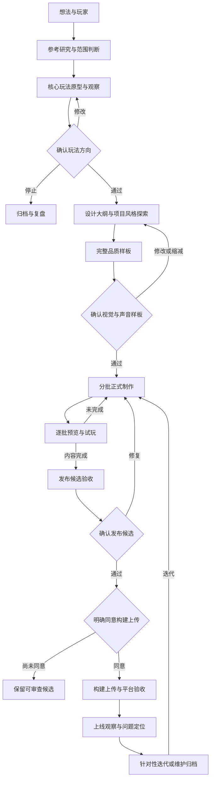

# 总流程与阶段标准

版本：1.0.0。通用阶段适用于 Maker 项目；横屏、无广告、无排行的项目按实际范围裁剪。不可用文档数量判断品质。

## 阶段表

| 阶段 | 输入 | 工作与交付 | 通过依据 | 不通过时 |
|---|---|---|---|---|
| 立项 | 用户想法、平台与开发条件 | 明确玩家、场景、体验卖点、范围、风险，填项目设计书首节 | 能说清玩家做什么、为什么愿意尝试、如何用小原型验证 | 修改或归档，不先扩系统 |
| 参考研究 | 题材、核心行为 | 找直接竞品、表现参考、实现案例，写借鉴点和差异 | 有可观察例子和适用理由，不以星标代替判断 | 换参考或缩小目标 |
| 核心原型 | 核心循环假设 | 最少资源实现行动→决策→反馈→下一轮；记录试玩 | 关键操作可理解，选择有后果，玩家愿意继续的证据可描述 | 修改操作、节奏或方向；不以奖励堆叠补救 |
| 玩法确认 | 原型、观察与问题 | 向用户展示可玩的结果与取舍，记录明确答复 | 用户认可核心方向 | 留在原型阶段 |
| 设计与风格 | 已确认方向、成本 | 完成大纲、页面清单、风格板、字体样张和声音目标 | 范围与资源可负担，风格规则可执行 | 缩范围、重新选型 |
| 品质样板 | 风格规则与核心原型 | 一段完整首局，含真实 UI、美术、声音、奖励与异常反馈 | 实际效果一致、可读、可操作，不依赖大量口头解释 | 定位缺口，集中修订；必要时回原型 |
| 样板确认 | 可展示样板、比较与检查结果 | 用户确认视觉与声音方向，冻结样板规则 | 有明确记录；静默或等待不算同意 | 不批量扩展资源 |
| 正式制作 | 已确认样板、里程碑 | 按体验闭环分批实现，每批完成预览与受影响检查 | 当批内容可用且延续样板标准 | 修当批问题，不继续累积缺口 |
| 发布候选 | 内容完成、缺陷表 | 完整首局、主要成长路径、存档、性能与平台风险验收 | 阻断问题关闭；剩余风险有用户知情记录 | 修复、缩减或延期 |
| 上传与验收 | 用户明确上传授权 | 按当前 Maker 文档构建上传，记录构建结果与平台证据 | 构建、设备、广告、云存档等分别有证据 | 区分工具失败与产品失败，禁止无依据重复上传 |
| 迭代 | 分环节数据、玩家反馈 | 定位原因，提出有限改动并验证 | 指标口径一致、证据支持下一步 | 补证据，不盲目加内容 |

## 阶段使用规则

新项目从立项开始。已有项目从现状评估定位阶段；成熟玩法不因接入 SOP 强制重做。小改动读取相关专业规范与进度，完成针对性检查，不机械经过三个确认节点。改变已确认核心玩法或整体风格时，重新确认受影响方向。

三个人工节点面向游戏项目，不把 SOP 文档中的虚构示例当成已获批准的正式游戏。

## 相关文档

- [项目接入](项目接入.md)
- [立项与参考研究](立项与参考研究.md)
- [原型与品质样板](原型与品质样板.md)
- [正式制作与验收](正式制作与验收.md)
- [上线与迭代](上线与迭代.md)
